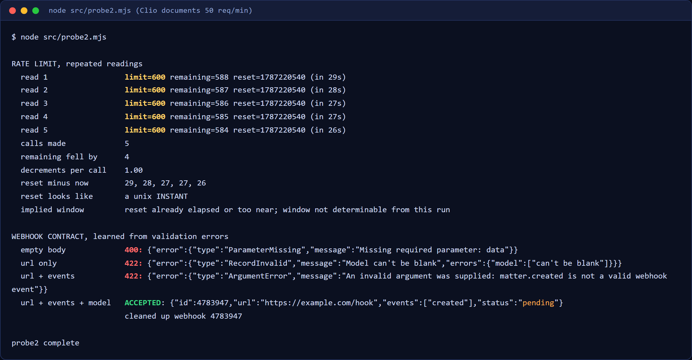
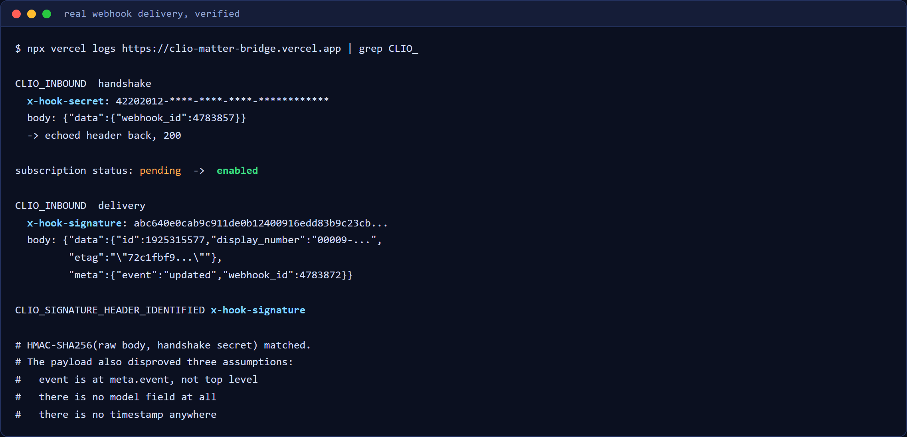

# clio-matter-bridge

[](https://github.com/Exalt24/clio-matter-bridge/actions/workflows/ci.yml)

**Clio Manage integration measured against the real API: OAuth 2.0, a verified webhook receiver, a deny-by-default model boundary.** It also has a token refresh grant, a rate-limit-aware paginating client, and a webhook receiver checked against real deliveries.


*A clean clone running `npm test`: five offline suites and three mutation controls pass, and the live suite skips because it needs your own Clio account. The screen is replayed from the real output of that run.*

Zero runtime dependencies. Node 20+ built-ins only, so it clones and runs with no install step.

```sh
cp .env.example .env      # client id + secret from developers.clio.com
npm run auth              # prints an authorize URL; click Allow
node src/probe.mjs        # live reconnaissance against your own account
npm test                  # every suite, plus the mutation controls
```

## Status, stated precisely

Built and tested against a live Clio Manage **developer trial** account. The account holds sample records created by `src/seed.mjs`. The trial expired on 2026-08-27, so the live suite (25 of the 265 assertions) needs your own Clio account, and `npm test` reports it as FAILED when a stale `.tokens.json` is present; the other 240 run offline with no account, and so do the 12 on the deployed function.

## Why this exists

Some of Clio's documentation is missing or hard to find, and several of my own assumptions were wrong. Both kinds of error were found by hitting the real API rather than reading about it. One correction runs the other way, and it is in the table below: I briefly believed the documented rate limit was wrong, and it was not.



| Behaviour | Documented | Measured |
|---|---|---|
| Rate limit | 50/min at peak, "increased during off-peak hours" | **varies**: observed 600 off-peak (the saved screenshot); a 50 afternoon reading was seen once and not saved. The docs were right; read the header |
| Webhook contract | the docs page 404s | reverse-engineered from validation errors, then proven end to end |
| Redirect URI (measured 2026-08-20, output not kept) | not stated | the portal rejects `localhost`; requires `https` or `http://127.0.0.1` |
| Offset pagination | 10,000-record ceiling | confirmed, 422 past it, so paging here is cursor-only |
| `fields` omitted | "minimal default set" | confirmed: `description` is simply absent unless asked for |
| Manage OAuth host | ambiguous vs Platform | `app.clio.com/oauth/*`; `auth.api.clio.com` is a different product |

The rate limit is the one that taught me most, because I got it wrong first. Seeing 600 once, I declared the documented 50 incorrect and hardcoded the faster pace. Later the same day the header read 50, which is peak, exactly as documented. **A single reading of a varying value is not a measurement.** The client now derives its pacing from `X-RateLimit-Limit` on every response and keeps a third of the budget as headroom.

## Webhooks, proven rather than assumed

A receiver was deployed, a subscription registered against it, and real events triggered by creating and patching a matter.



- The handshake arrives as `x-hook-secret: <uuid>` with body `{"data":{"webhook_id":N}}`. Echo the header back with a 200 and the subscription moves from `pending` to `enabled`.
- Deliveries carry `x-hook-signature`, an HMAC-SHA256 of the **raw** body keyed on the handshake secret.
- Subscriptions carry `expires_at` roughly **three days** out and must be renewed.
- Point a subscription at a **stable alias**, because the next deploy orphans an immutable URL.

**The real payload disproved three assumptions** taken from a third-party guide, because Clio's own webhooks page returns 404:

1. The event name is at `meta.event`, **not** the top level.
2. There is **no `model` field** in a delivery at all. Model belongs to the subscription.
3. There is **no timestamp anywhere**, so a replay guard that requires one rejects every genuine event. That guard is now opt-in, with a test pinning the default so re-enabling it by accident fails locally instead of in production.

Better than expected: `data.etag` changes between versions of one record, so `id` + `etag` is the right idempotency key. A genuine update is not swallowed as a duplicate of the create.

Captured bytes are committed in [`tests/fixtures/`](tests/fixtures/), with a README recording what each one disproved.

## The confidentiality boundary

The part that makes this a legal tool rather than a CRM sync. ABA Model Rule 1.6 covers *all* information relating to a representation, and [ABA Formal Opinion 512](https://www.americanbar.org/news/abanews/aba-news-archives/2024/07/aba-issues-first-ethics-guidance-ai-tools/) (July 2024) applies that to generative AI directly.

```js
import { prepareForModel, MATTER_ALLOWLIST } from './src/lib/confidentiality.mjs';

const { outbound, audit } = prepareForModel(matter, { allowlist: MATTER_ALLOWLIST });
// outbound  -> {"id":42,"status":"Open","open_date":"2026-08-01","billable":true}
// audit     -> { fields_sent, fields_withheld, outbound_sha256, identifiers_replaced }
```

- **Deny by default.** A field reaches a model only if it is on an explicit allowlist. `description` is deliberately excluded, because firms write "Smith v. Jones" in it.
- **A denylist would be the wrong shape**, and not for stylistic reasons: a denylist fails *open*, so the day the vendor adds a field it is transmitted because nobody thought to forbid it.
- **An identifier that survives the allowlist raises**, rather than being quietly scrubbed. A survivor means the allowlist is wrong, and scrubbing hides that.
- **Pseudonyms are stable**, so a model can still reason about "the same party" without learning who they are.
- **The audit record stores a sha256 of what left plus the field names, never the content**, so the audit log is not a second copy of the confidential data.

Disabling the allowlist in a mutation test did not silently pass: the secondary identifier sweep caught the case caption and refused to send. It fails **closed**.

## Tests

**265 assertions across six suites, plus 12 on the deployed function.** `tests/run_all.sh` runs them all, then **breaks five guards on purpose** and asserts the relevant suite goes red, because a suite that cannot fail is not a suite.

| Suite | Checks | Covers |
|---|---|---|
| `oauth.test.mjs` | 64 | regions, redirect rule, token normalisation, expiry, wire format |
| `client.test.mjs` | 32 | fields builder + its 1000-char cap, header parsing, adaptive pacing |
| `webhook.test.mjs` | 72 | signature, replay, idempotency, dispatch, error propagation |
| `confidentiality.test.mjs` | 47 | allowlist, identifier detection, pseudonyms, audit record |
| `captured.test.mjs` | 25 | the real bytes Clio sent |
| `function.test.mjs` | 12 | the deployed function: the handshake is echoed, and no secret or signature value reaches the log |
| `live.test.mjs` | 25 | live API: pagination, fields, filtering, and the refresh grant |

One test here was **found to be passing for the wrong reason.** The redirect-URI guard rejects `localhost`, and the assertion matched `/localhost/`. Deleting the guard left the suite green at 64/64, because the generic fallback error echoes the offending URI back and therefore contains the word. The assertion now matches the phrase unique to the dedicated branch, and the same deletion produces failures.

That is why the mutation controls exist. A green suite is evidence only if you have watched it go red.

A later sweep broke **ten** guards one at a time by hand and asserted the relevant suite went red for each. Nine had teeth; the tenth, the `fields` length cap, **stayed green**, because it was enforced in code and asserted nowhere. `package.json` also referenced a `tests/client.test.mjs` that did not exist, so `test:offline` had been running one fewer file than it claimed. Writing that suite immediately found a second latent bug: `parseRateLimit` did a case-sensitive lookup, so a plain object carrying `X-RateLimit-Limit` returned null and pacing silently fell back to its opening guess. Both fixed.

That ten guard sweep (commit e6bc4d5) is not committed as a script, so it cannot be re-run from the repo. What `npm test` re-runs is five of the controls: the redirect guard, the webhook signature compare, the confidentiality allowlist and the two log redactions of the deployed function. CI runs only the six offline suites (`npm run test:offline`), not the mutation controls. The controls need Python; without it `tests/run_all.sh` now fails instead of printing a skip, and it also fails if a target string has moved.

## Layout

```
src/lib/regions.mjs          four regional instances; a token is not valid across them
src/lib/config.mjs           config, and the redirect-URI rule enforced at startup
src/lib/clio-oauth.mjs       authorization code, refresh, token persistence
src/lib/clio-client.mjs      throttle, retry, cursor pagination, fields builder
src/lib/webhook.mjs          signature, replay window, idempotency, dispatch
src/lib/confidentiality.mjs  the allowlist chokepoint and audit record
src/authorize.mjs            one-shot local OAuth callback server
src/probe.mjs, probe2.mjs    live reconnaissance; how the findings above were made
src/seed.mjs                 sample records, with a refusal guard and --undo
src/server.mjs               local receiver that logs every header verbatim
api/clio-webhook.js          evidence logger on a serverless host: echoes the handshake secret, logs the headers with secret and signature values reduced to a length and a hash (the handshake secret is written out only when `CLIO_LOG_HANDSHAKE_SECRET=1` is set on purpose), always answers 200 and does not reject a bad signature. Signature checks, replay and idempotency live in src/lib/webhook.mjs, used by the local receiver src/server.mjs
```

`src/seed.mjs` **refuses to run** against an account holding more records than it creates, because the cost of being wrong about which account you are pointed at is asymmetric. `--undo` deletes by id only what it created.

## Next steps

- **The repo stops at the model boundary.** `prepareForModel` is the checkpoint a language model call would go through, and it is tested; an LLM client and intake-to-matter extraction come next.
- **Clio administration.** This is API work. Configuring matters, contacts, calendaring, tasks, documents, billing and intake inside Clio is a separate skill, and no amount of API work substitutes for it.
- **Conflict-of-interest checking on intake**, the workflow that is genuinely harder in law than elsewhere. Clio exposes a conflict-check scope in global search; this repo does not use it yet.
- **Renewal automation** for the roughly three-day webhook expiry.

## License

MIT.
